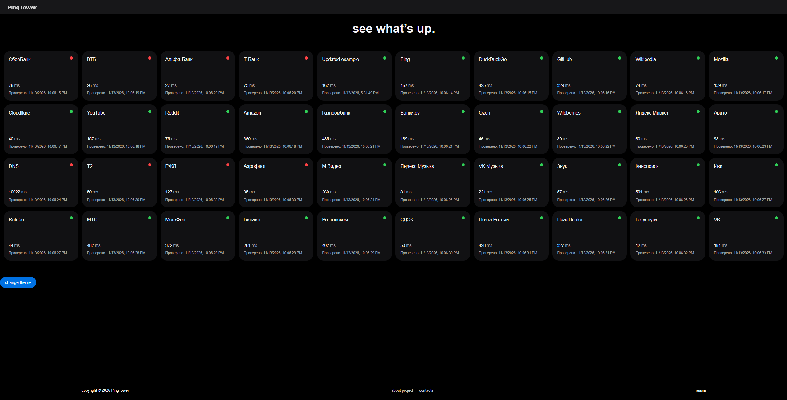
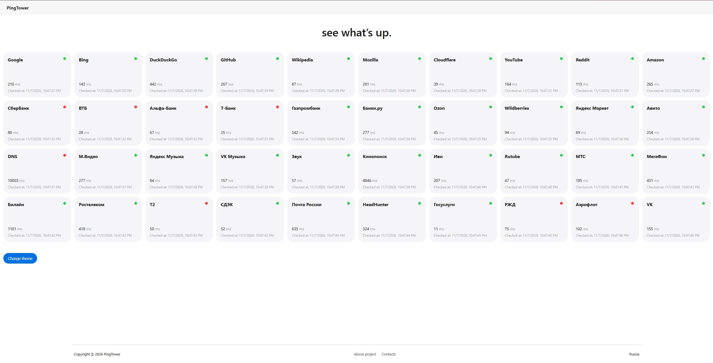
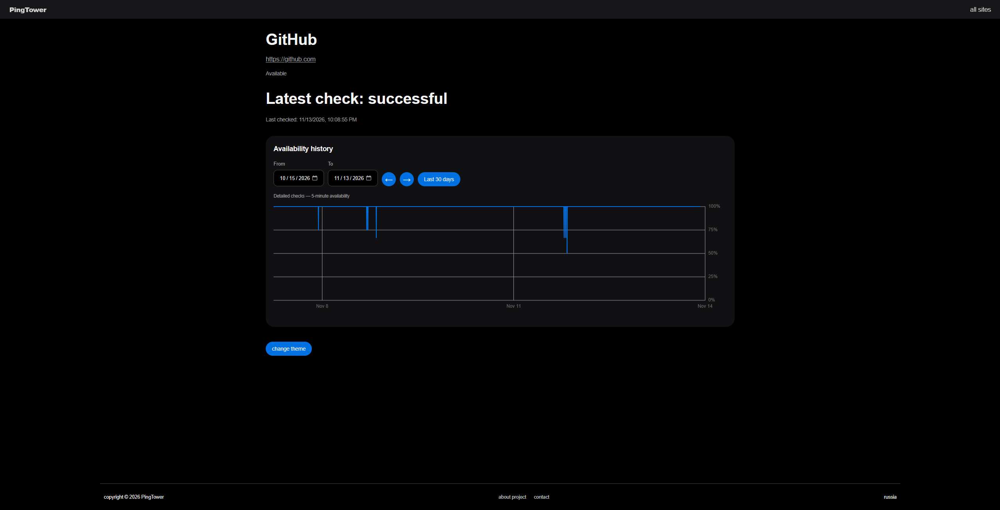
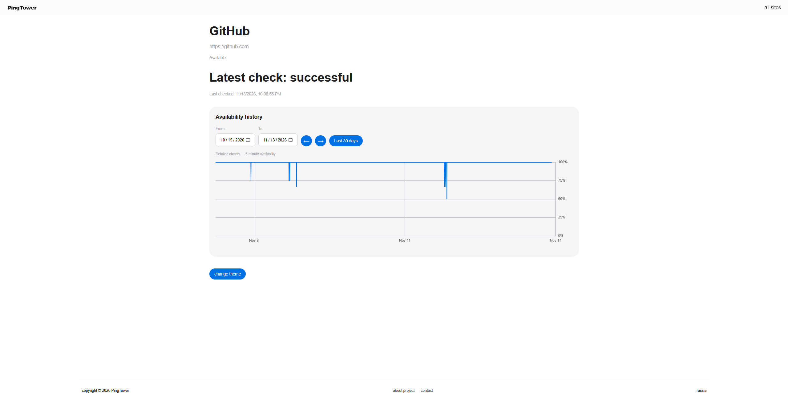

# PingTower

**website uptime monitoring, built with go**

---

track website health, report incidents, and explore uptime history.

        

> [!NOTE]
> this project is under active development. some components and features are planned and may not be implemented yet.

## about

pingtower is a website monitoring service. visitors can view website statuses and incident history. registered users can report incidents.

## tech stack

- **languages:** go + sql + html + css + typescript
- **backend:** gin + rest api
- **database:** postgresql + goose migrations
- **cache and rate limiting:** redis
- **security:** bcrypt
- **infrastructure:** docker + docker compose
- **testing and ci:** go test + github actions

## preview

## components

- [x] **sites** — manages monitored websites.
- [x] **checker** — probes enabled websites and records results and daily statistics.
- [x] **nginx** — reverse proxy and entry point for the services.
- [x] **stats** — serves historical statistics and chart data.
- [x] **frontend** — displays statuses, charts, and incident reports.
